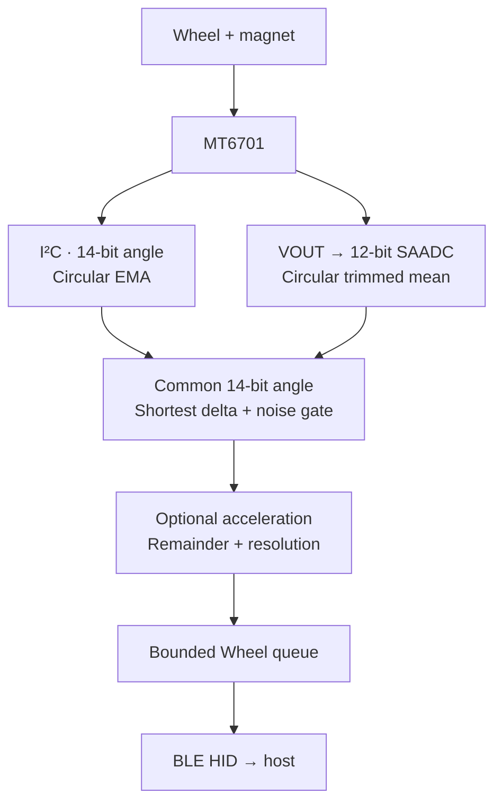

# DialScroll architecture

[English](ARCHITECTURE.md) · [Русский](ARCHITECTURE.RU.md) · [Project overview](README.md)

DialScroll converts the absolute angle of an MT6701 magnetic sensor into a BLE HID mouse Wheel on an nRF52840. The firmware combines circular signal processing, power scheduling and asynchronous BLE delivery. `DialScroll` is the project name, `blescroll` identifies firmware targets and settings, and `AirScroll` is the advertised Bluetooth name.

## Signal path and module boundaries



| Module | Responsibility |
|---|---|
| [`src/main.c`](src/main.c) | Startup order and diagnostic profiles |
| [`src/encoder.c`](src/encoder.c) | Power control, I²C/ADC reads and idle/active scheduling |
| [`src/encoder_math.c`](src/encoder_math.c) | Circular filtering, fixed-point acceleration and Wheel scaling |
| [`src/scroll_resolution.c`](src/scroll_resolution.c) | Persistent resolution, acceleration and angle source |
| [`src/ble_hid.c`](src/ble_hid.c) | Advertising, bonding, HIDS and asynchronous Wheel delivery |
| [`src/battery.c`](src/battery.c), [`src/battery_math.c`](src/battery_math.c) | Battery acquisition and voltage-to-percentage mapping |
| [`src/diagnostics.c`](src/diagnostics.c) | VBUS-gated USB CDC, commands and runtime snapshots |
| [`src/heartbeat.c`](src/heartbeat.c) | Status LED through delayed work |

Hardware assignments live in [`app.overlay`](app.overlay); tuning constants live in [`include/app_config.h`](include/app_config.h). The math module is tested independently of sensor and Bluetooth hardware.

## Hardware interface and battery monitoring

The target is a Tenstar Robot ProMicro-compatible nRF52840 board with a `nice!nano`-compatible UF2 bootloader.

| Signal | Connection |
|---|---|
| MT6701 VDD | 3.3 V through a load switch |
| Load-switch enable | P0.17, active high, high drive |
| MT6701 GND | Common GND |
| MT6701 SDA / SCL | P1.00 / P0.11, I²C0 at 400 kHz, address `0x06` |
| MT6701 Analog/VOUT | P0.02 / AIN0 |
| Battery divider midpoint | P0.04 / AIN2 |
| Status LED | P0.15, active high |

The I²C configuration uses MODE HIGH (or the sensor's internal pull-up) and CSN HIGH. Firmware leaves these inputs under hardware control. SDA/SCL have internal pull-ups; external pull-ups to 3.3 V, typically 4.7 kΩ, support the 400-kHz bus. A 100-nF decoupling capacitor belongs near sensor VDD. The load switch supplies the sensor; P0.17 controls its enable. Direct GPIO supply is a short bench-test configuration.

For VOUT acquisition, the sensor output must be configured as Analog. The default calibration endpoints are ADC codes `0` and `4095`; `ENCODER_VOUT_MIN_CODE` and `ENCODER_VOUT_MAX_CODE` support measured clamp endpoints. The ADC uses `ADC_GAIN_1_4`, `ADC_REF_VDD_1_4`, 12-bit resolution, 10-µs acquisition and Devicetree oversampling value `2`. A shared sensor/ADC supply makes the measurement ratiometric.

The battery divider is `BAT+ → 806 kΩ → AIN2 → 2 MΩ → GND`:

```text
Vbat = Vadc × 2,806,000 / 2,000,000
```

The battery ADC uses an internal reference, `ADC_GAIN_1_6`, 12-bit resolution and 40-µs acquisition for the high-impedance divider. Each update discards the first conversion and averages the next eight. The first update is scheduled after 1 second; subsequent updates run every 60 seconds. Linear interpolation maps 3.30 V to 0%, 3.70 V to 50% and 4.20 V to 100%, with saturation at the endpoints. This is a configurable starting curve for a single Li-ion/LiPo cell.

The standard Battery Service (`0x180F`, Battery Level `0x2A19`) receives a new value when the percentage changes. The host's Bluetooth driver determines where the percentage appears in its UI. The heartbeat leaves the LED off for 8 seconds, then on for 150 ms, using `k_work_delayable`.

## Circular angle acquisition

Both sources produce a common angle in `0…16383`, representing one revolution. I²C is the default source. One combined transaction reads MT6701 registers `0x03/0x04` and decodes `(msb << 6) | (lsb >> 2)`.

The I²C path applies an exponential moving average with Q8 state and α=`64/256`=`1/4`. Each update takes the shortest circular difference between the raw angle and filtered state, applies the correction and wraps the result modulo 16384. The first reading initializes the filter. Crossing zero therefore follows the local arc instead of averaging opposite sides of a linear scale.

The ADC path builds one angle from eight readings:

1. Normalize each 12-bit sample to the calibrated 14-bit angle domain.
2. Unwrap the samples around the first sample using shortest-arc differences.
3. Sort, discard the lowest and highest samples, and average the remaining six.
4. Wrap the mean modulo 16384.

For example, ADC values `4094, 4095, 0, 1` describe nearby positions around zero. Circular processing keeps this cluster near zero. Motion uses the same geometry:

```text
delta = current - previous
if delta >  8192: delta -= 16384
if delta < -8192: delta += 16384
```

The resulting delta represents the shortest displacement between readings. A pair of absolute angles resolves motion within half a revolution; the idle cadence trades detection delay and this angular ambiguity against sensor duty cycle. Active acquisition reduces the interval after motion is detected.

## Sensor power and scheduling

Normal operation uses `System ON idle`, retaining RAM and the BLE connection between events. `encoder_run()` occupies the main thread and sleeps to absolute deadlines; Bluetooth and Zephyr work queues run in their own contexts.

| State or transition | Behavior |
|---|---|
| Disconnected | Sensor remains off; tracking state and fractional Wheel remainder reset |
| First valid reading after boot/reconnect | Capture baseline without a Wheel event; begin at the 200-ms idle cadence |
| Idle probe | Power on, wait 33 ms, read selected source, compare to baseline, power off if stationary |
| Recent activity | Probe every 100 ms for 10 seconds after the last movement |
| Settled idle | Probe every 200 ms |
| Idle → active | `abs(delta) > 32` angle counts; process initial motion and keep sensor powered |
| Active | Schedule reads every 2 ms; accept motion when `abs(delta) > 16` |
| Active → idle | 400 ms without significant movement; power off and schedule next probe after 100 ms |

Subthreshold samples leave the motion reference unchanged, allowing slow movement to accumulate across readings. Active deadlines advance by 2 ms rather than by processing time plus a sleep. The configured period is a scheduling target; a GPIO marker or timestamps give the actual acquisition interval, including the ADC burst and processing.

The earlier bench investigation recorded four VOUT startup captures with the output transition at approximately **32.62–32.65 ms** after power-on. The current 33-ms stabilization constant follows that observation. The startup diagnostic profile supports repeating this capture with ADC selected as described below.

The stabilization wait alone corresponds to a calculated duty contribution of 33/200 = 16.5% in settled connected idle and 33/100 = 33% during the fast window. Acquisition adds to these figures. The bench procedure records whole-device current separately for advertising, connected idle and active scrolling.

## Wheel resolution and fixed-point acceleration

One legacy Wheel detent corresponds to **256 counts** of the 14-bit angle domain. The HID descriptor always advertises a Resolution Multiplier of ×16. Runtime resolution changes event granularity while preserving the distance represented by a revolution:

| User mode | Angle counts per emitted chunk | Chunk in advertised ×16 units |
|---|---:|---:|
| `off` / ×1 | 256 | 16 |
| ×8 | 32 | 2 |
| ×16, default | 16 | 1 |

`encoder_scroll_accumulate()` retains angular remainder between conversions, including idle/active transitions while connected. `ENCODER_SCROLL_DIRECTION` selects the sign and currently equals `1`. A host enables high-resolution units by writing the HID Feature report. For a host that leaves the feature disabled, the BLE layer accumulates ×16 units into legacy detents. This keeps total sensitivity consistent across host capabilities and user resolution modes.

Acceleration is an independent persistent option, disabled by default. After 2048 counts (45°) of continuous motion in one direction, its Q8 factor rises linearly from ×1 at 6552 counts/s (approximately 0.4 rev/s) to ×2 at 32768 counts/s (2 rev/s). Speed uses eight 10-ms buckets, an 80-ms window, advanced by active samples. The initial displacement detected in idle is delivered at ×1 and excluded from the speed estimate.

Scaling precedes resolution conversion. Signed Q8 remainder preserves fractional movement symmetrically in both directions. Reversal, a 100-ms pause, disconnect or an acceleration setting change restarts acceleration at ×1. Zero-motion samples advance the speed window and emit zero movement, so acceleration adds no scrolling after motion stops.

## BLE delivery and concurrency

The device exposes a four-byte encrypted mouse input report: buttons/padding, X, Y and signed relative Wheel. Only Wheel varies. A one-byte Feature report selects the host's effective multiplier: logical `0` gives ×1, logical `1` gives ×16. Boot mouse protocol has no Wheel field; selecting boot mode clears pending Wheel, and report mode restores delivery.

Advertising uses `AirScroll` and `BT_LE_ADV_CONN_FAST_2`. The firmware supports one active connection and stores up to two bonds. It requests security level L2 and a preferred connection interval of 7.5–10 ms, latency 0 and supervision timeout 420 ms. The central chooses the final parameters; diagnostics show the negotiated values. Both flash variants use the Zephyr Bluetooth stack from NCS; the `sd` name describes the existing flash layout.

The transport separates sampling from sending:

- The encoder enqueues relative movement; Zephyr delayed work calls the HIDS send API.
- A mutex protects the active connection and report-mode state. Sending holds a `bt_conn_ref()` reference.
- An atomic accumulator stores pending Wheel, saturated at ±2048. Addition uses a widened intermediate.
- One notification is in flight at a time. Each send drains up to ±127 units; its completion callback schedules the next chunk.
- Failed sends retry at 5-ms intervals. The 25th failed attempt clears pending movement and logs a warning.
- Disconnect clears pending delta, legacy remainder and notification/retry state, then schedules advertising.

Battery updates and heartbeat also use delayed work. USB receive interrupts place command bytes in a bounded message queue; work-queue handlers perform settings changes and diagnostics outside the interrupt context.

## Persistent settings and error behavior

Settings use the 32-KiB NVS storage partition below the UF2 bootloader, alongside Bluetooth bonding.

| Key | Values and default |
|---|---|
| `blescroll/scroll_resolution` | `0`: off, `1`: ×8, `2`: ×16; default ×16 |
| `blescroll/acceleration` | `0`: disabled, `1`: enabled; default disabled |
| `blescroll/encoder_mode` | `0`: I²C, `1`: ADC; default I²C |

Setters validate input and publish the new runtime value only after `settings_save_one()` succeeds. Missing or malformed source settings retain I²C. Switching source ends the active cycle, powers down and resets baseline, EMA, acceleration and angular remainder. The first reading from the new source establishes baseline. Wheel events already accepted by the BLE queue continue through transport.

| Event | Firmware response |
|---|---|
| Power GPIO, SAADC or I²C peripheral unavailable | Encoder initialization returns an error |
| Sensor power-on fails | Log and retry at the next idle deadline |
| ADC read fails in idle / active | Power off; preserve baseline / end active with last valid angle |
| I²C read fails or NACKs | Power off, reset tracking and retry I²C on the next probe; log at most once per second |
| Settings write fails | Return the error and retain the current runtime setting |
| BLE disconnect | Clear transport state; capture a fresh baseline after reconnect |
| Stale peer key causes pairing failure | Mark that peer, remove its conflicting bond after disconnect, allow a fresh pairing attempt |
| Battery read fails | Retain last reported level and schedule the next update |
| Reset | Initialize fresh tracking state and capture baseline before sending motion |

## USB diagnostics

The product image enables USB CDC only while VBUS is present. Logging starts disabled, with runtime source filters at `LOG_LEVEL_NONE`. A serial terminal at `115200 8N1` can send individual bytes; CR/LF is optional and ignored.

| Byte | Product-image action |
|---|---|
| `h` | Show help, settings, selected/active source and last read error |
| `D` | Enable logs and print a fresh USB/BLE/encoder/battery snapshot; repeat for another snapshot |
| `d` | Disable diagnostic output |
| `0`, `1`, `2` | Save resolution off, ×8, ×16 |
| `A`, `a` | Save acceleration enabled, disabled |
| `V`, `v` | Save angle source ADC, I²C |
| `U` | Enter UF2 bootloader after a 50-ms delay (`GPREGRET = 0x57`, cold reset) |

Settings commands work with logging disabled. Disconnecting USB disables logs and the USB controller, purges queued commands and leaves BLE scrolling under its normal connection rules. Diagnostic enablement resets on USB removal; persistent settings survive power cycles.

Dedicated profiles enable USB/logging from startup. `-Diagnostic` runs the encoder without BLE; `-DiagnosticBle` includes BLE and its connection gate. These profiles use streaming logs rather than the product byte-command interface. `-EncoderStartupDiagnostic` waits for any byte and captures up to 1024 samples during the first 50 ms of sensor power. CSV sample output is deferred until power-off; read-error diagnostics may be logged during capture.

Startup capture uses the persisted angle source, defaulting to I²C. For a VOUT capture, command `V` in the product image first saves ADC selection. Flashing the startup profile preserves that setting; sending any byte then starts the ADC capture. Source-selection commands belong to the product image; the startup profile treats received bytes as capture triggers.

## Boot layout and the UF2 fix

The bootloader reads the initial stack pointer and Reset handler from the application's vector table. In the original NCS 3.2.4 build investigation, generated UF2 blocks began at `0x26000` while the Reset vector remained `0x00000C01`. Copying the image succeeded, but reset execution pointed into the reserved SoftDevice area.

The fix links the application at its physical flash address and converts the linked Intel HEX with `uf2conv.py`, preserving those addresses. [`CMakeLists.txt`](CMakeLists.txt) generates this custom UF2 target; `CONFIG_BUILD_OUTPUT_UF2=n` disables the automatic path.

| `INFO_UF2.TXT` entry | Variant | Application range, end exclusive | Product UF2 |
|---|---|---|---|
| `SoftDevice: S140 6.1.1` | `sd` | `0x26000…0xEC000` | `blescroll.uf2` |
| `SoftDevice: not found` | `nosd` | `0x1000…0xEA000` | `blescroll_nosd.uf2` |

[`tools/verify_uf2.py`](tools/verify_uf2.py) checks file size/alignment, UF2 headers, expected start address, Reset handler Thumb bit and application range, and nRF52840 family ID `0xADA52840`. The build helper and CI use this validator. Choosing the matching layout gives the bootloader a correctly addressed vector table.

## Build and flash procedures

The pinned SDK is [nRF Connect SDK 3.2.4](https://docs.nordicsemi.com/bundle/ncs-3.2.4/page/nrf/index.html). Commands run in its installed toolchain environment with `ZEPHYR_BASE` pointing to that SDK's `zephyr` directory. The build uses [sysbuild](https://docs.nordicsemi.com/bundle/ncs-3.2.4/page/zephyr/build/sysbuild/index.html) and board `promicro_nrf52840/nrf52840/uf2`.

Windows helper commands from the checkout root:

```powershell
.\build.ps1 sd
.\build.ps1 nosd
.\build.ps1 nosd -Diagnostic
.\build.ps1 nosd -DiagnosticBle
.\build.ps1 nosd -EncoderStartupDiagnostic
```

`-NcsRoot C:\ncs\v3.2.4` selects an installation explicitly. The helper finds its registered toolchain and validates the resulting image. Sysbuild names the application subdirectory after the checkout directory. With the default checkout name `DialScroll`, outputs are:

| Profile | Output |
|---|---|
| `sd` product | `build/DialScroll/blescroll.uf2` |
| `nosd` product | `build-nosd/DialScroll/blescroll_nosd.uf2` |
| `nosd` diagnostic | `build-nosd-diagnostic/DialScroll/blescroll_nosd_diagnostic.uf2` |
| `nosd` diagnostic + BLE | `build-nosd-diagnostic-ble/DialScroll/blescroll_nosd_diagnostic_ble.uf2` |
| `nosd` startup capture | `build-nosd-startup-diagnostic/DialScroll/blescroll_nosd_startup_diagnostic.uf2` |

Portable `sd` product build, from the checkout root:

```sh
APP="$(pwd)"
APP_NAME="${APP##*/}"
west -z "$ZEPHYR_BASE" build --sysbuild -p always \
  -b promicro_nrf52840/nrf52840/uf2 -d "$APP/build" "$APP" \
  -- "-DCONF_FILE=$APP/prj.conf"
python "$APP/tools/verify_uf2.py" \
  "$APP/build/$APP_NAME/blescroll.uf2" --variant sd
```

For other profiles, use the corresponding build directory above and this ordered `CONF_FILE` list, prefixing each file with `$APP/`:

| Profile | Configuration fragments, separated by `;` |
|---|---|
| `nosd` product | `prj.conf;prj_nosd.conf` |
| `nosd` diagnostic | `prj.conf;prj_nosd.conf;prj_diagnostic.conf` |
| `nosd` diagnostic + BLE | `prj.conf;prj_nosd.conf;prj_diagnostic.conf;prj_diagnostic_ble.conf` |
| `nosd` startup capture | `prj.conf;prj_nosd.conf;prj_diagnostic.conf;prj_encoder_startup_diagnostic.conf` |

The quoted `-DCONF_FILE=…` argument keeps the semicolon list together. Validate these images with `--variant nosd` and the corresponding filename.

Flashing and first connection:

1. Double-press Reset to mount `NICENANO`; read `INFO_UF2.TXT` and select the matching variant. A running product image also accepts `U` over USB CDC to enter the bootloader.
2. Copy the validated UF2 to `NICENANO`. The volume disconnects as the board restarts.
3. Pair with `AirScroll`, rotate both ways, stop and reconnect. The first reading establishes baseline.
4. Connect USB, open the serial port and send `h`, then `D` for a snapshot. Send `d` to finish diagnostics.

After HID descriptor changes, removing `AirScroll` from the host and pairing again refreshes the host's cached report map. The log `High-resolution Wheel enabled (effective multiplier x16)` confirms that the host selected the feature. A stale-bond message calls for another pairing attempt after the firmware clears the conflicting peer key.

## Automated and hardware verification

The two ztest suites contain **31 cases**: 25 for angle/battery math and six for persistent settings. They cover decoding, circular wrap, EMA convergence, trimmed filtering, retained remainder, resolution distance/granularity, acceleration curve and resets, battery interpolation, settings reload and failed writes.

```sh
python "$ZEPHYR_BASE/scripts/twister" -T "$APP/tests" \
  -p qemu_cortex_m3 --inline-logs -O "$APP/twister-out"
```

[`ci.yml`](.github/workflows/ci.yml) uses the official Nordic container pinned to NCS 3.2.4. The complete run can be reproduced from the checkout root with Docker:

```sh
docker run --rm --entrypoint /bin/bash \
  -v "$PWD:/work/DialScroll" -w /work/DialScroll \
  ghcr.io/nrfconnect/sdk-nrf-toolchain:v3.2.4@sha256:397bac78a3e3825ce30443d4cd28c377ea6e5a28910200820967b648d95f88bb \
  tools/ci.sh
```

[`tools/ci.sh`](tools/ci.sh) loads the toolchain environment, shallow-clones SDK tag `v3.2.4` and verifies commit `4c3fc0d44534f387a2d623eb1c85cbd2ffc8bcb6`. It initializes west from that manifest, excludes Matter, fetches the selected projects and freezes the active manifest. It then runs 10 Python standard-library tests for the UF2 validator, the 31 ztests and all five firmware builds, validating every generated UF2.

Firmware images and their HEX, ELF and configuration files are collected in `artifacts/firmware/`. The complete log is `artifacts/ci.log`, the frozen manifest is `artifacts/west-manifest.yml`, and test reports remain in `twister-out/`. The UF2 validator tests also run independently from the checkout root:

```sh
python -m unittest discover -s tests/uf2 -v
```

Hardware verification exercises pairing/reconnect, both rotation directions and zero crossing, slow movement, quick reversal, resolution changes, acceleration enable/disable, source changes and USB removal during BLE scrolling. Startup capture supplies timestamped readings and errors for repeated power cycles. Power measurements use battery supply with USB disconnected, recording advertising, connected idle and active scrolling separately. A GPIO marker around acquisition measures ADC burst time and actual active intervals; a motion-to-HID trace measures response delay. These measurements guide calibration endpoints, motion thresholds and sampling cadence.

## Reference material

- MagnTek, [MT6701 Rev.1.8 datasheet](https://www.magntek.com.cn/upload/pdf/202407/MT6701_Rev.1.8.pdf): angle interfaces, power-on timing and analog output configuration.
- Nordic Semiconductor, [nRF52840 Product Specification](https://docs.nordicsemi.com/bundle/nRF52840_PS_v1.9/page/keyfeatures_html5.html): SAADC, GPIO and power modes.
- Nordic Semiconductor, [NCS 3.2.4 documentation](https://docs.nordicsemi.com/bundle/ncs-3.2.4/page/nrf/index.html) and its [sysbuild reference](https://docs.nordicsemi.com/bundle/ncs-3.2.4/page/zephyr/build/sysbuild/index.html).
- Repository sources linked above, [`tests/`](tests/) and [`include/app_config.h`](include/app_config.h) define the implemented behavior and configuration.
