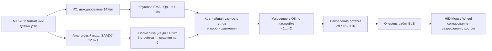

# DialScroll

[English](README.md) · Русский

DialScroll — прошивка беспроводного колеса прокрутки на магнитном датчике угла
MT6701 и плате nRF52840 с UF2-загрузчиком `nice!nano`. Она преобразует абсолютный
угол в стандартные отчёты BLE HID Mouse Wheel.

Проект объединяет работу с датчиком, обработку сигнала с фиксированной точкой,
адаптивное управление питанием и асинхронную передачу по BLE в приложении на
Zephyr / nRF Connect SDK. Цель сборки и файлы прошивки называются `blescroll`;
имя устройства в Bluetooth — **AirScroll**.

## Инженерные решения

| Область | Реализация и назначение |
|---|---|
| Круговая геометрия | Оба входа приведены к 14-битной шкале угла. Кратчайшая знаковая разность обрабатывает переход между `16383` и `0` без ложного скачка на полный оборот. |
| Фильтрация для каждого входа | В тракте I²C работает круговое экспоненциальное сглаживание с `α = 1/4` и состоянием в Q8. В тракте ADC восемь отсчётов разворачиваются относительно опорного угла; минимум и максимум отбрасываются, остальные шесть усредняются. |
| Квантование прокрутки | Накопители сохраняют дробные части шага прокрутки и результата ускорения в Q8. Режимы `off` / `×8` / `×16` меняют размер порций отчёта и сохраняют суммарное расстояние для одинакового входного движения. |
| Настраиваемое ускорение | Множитель `×1…×2` в Q8 использует окно движения 80 мс и активируется после 45° непрерывного вращения. Смена направления и паузы сбрасывают оценку. |
| Управление питанием датчика | GPIO управляет питанием при редких проверках в покое и частом опросе при движении. В обычном режиме датчик получает питание только при BLE-соединении; после переподключения прошивка заново определяет опорный угол. |
| Передача по BLE и сохранение настроек | Очередь работ передаёт накопленные отчёты Wheel по одному уведомлению, ограничивает повторные попытки и удерживает ссылку на соединение. NVS хранит ключи сопряжения, разрешение, ускорение и выбранный вход. |
| Загрузка UF2 | Приложение линкуется по физическому адресу во flash, затем Intel HEX преобразуется в UF2 с сохранением адресов. Это устраняет расхождение между перемещёнными блоками UF2 и вектором Reset. |

Реализация разделена на [автомат состояний энкодера](src/encoder.c),
[функции обработки сигнала](src/encoder_math.c),
[транспорт BLE](src/ble_hid.c) и [сохранение настроек](src/scroll_resolution.c).

## Тракт сигнала

HID-дескриптор объявляет Resolution Multiplier `×16`. Хосты, которые включают его
через Feature report, получают единицы высокого разрешения; остальные — обычные
шаги Wheel. Для этого преобразования транспорт хранит отдельный остаток.

## Настроенное поведение

Интервалы, пороги и масштаб прокрутки заданы в
[app_config.h](include/app_config.h).

| Состояние или параметр | Настройка |
|---|---|
| Вход по умолчанию | MT6701 по I²C, 400 кГц, адрес `0x06`; ADC выбирается во время работы |
| Стабилизация датчика | 33 мс после включения питания до чтения в режиме покоя |
| Проверки в покое | Каждые 100 мс в течение 10 с после движения, затем каждые 200 мс; при запуске — 200 мс |
| Опрос при движении | Один цикл измерения каждые 2 мс; возврат в покой через 400 мс без значимого движения |
| Пороги движения | В покое: больше 32 отсчётов; при движении: больше 16 отсчётов 14-битной шкалы |
| Масштаб прокрутки | 256 отсчётов угла на шаг колеса; разрешение по умолчанию — `×16` |
| Ускорение | По умолчанию выключено; после активации линейно растёт от `×1` при ≤0,4 об/с до `×2` при ≥2 об/с |
| Заряд аккумулятора | Усреднение восьми измерений ADC; обновление BLE Battery Service каждые 60 с |
| USB-диагностика | USB CDC включается при наличии VBUS; вывод логов — по команде `D` |

Распиновка, электрические соединения, переключение входов и диагностические
режимы описаны в [руководстве по архитектуре и аппаратной части](ARCHITECTURE.RU.md).

## Быстрая сборка и прошивка

Скрипт Windows [build.ps1](build.ps1) использует установленный **nRF Connect SDK
3.2.4** и зарегистрированный для него toolchain. Сборка запускается из корня
репозитория для выбранной ниже разметки загрузчика. Другой путь к SDK задаётся
параметром `-NcsRoot C:\ncs\v3.2.4`.

Двойное нажатие Reset открывает диск `NICENANO`. В его `INFO_UF2.TXT` указана разметка:

| Строка в `INFO_UF2.TXT` | Команда | Начало приложения | Результат для каталога проекта `DialScroll` |
|---|---|---|---|
| `SoftDevice: S140 6.1.1` | `.\build.ps1 sd` | `0x26000` | `build/DialScroll/blescroll.uf2` |
| `SoftDevice: not found` | `.\build.ps1 nosd` | `0x1000` | `build-nosd/DialScroll/blescroll_nosd.uf2` |

Скрипт определяет каталог результата по имени каталога проекта и проверяет UF2
перед сообщением об успешной сборке. Разметка flash определяет, какой образ
сможет запустить загрузчик.

1. Копирование выбранного UF2 на `NICENANO` автоматически перезагружает плату.
2. В настройках Bluetooth компьютера выполняется сопряжение с **AirScroll**.
3. Вращение колеса в обе стороны позволяет проверить HID-прокрутку.
4. При подключённом USB доступен порт CDC `115200 8N1`: байт `h` выводит справку,
   `D` — снимок состояния и текущие сообщения; `d` выключает вывод.

Однобайтовые команды `0` / `1` / `2` выбирают разрешение, `A` / `a` включают и
выключают ускорение, `V` / `v` выбирают ADC / I²C. Эти настройки сохраняются
после выключения питания. Команда `U` перезагружает плату в UF2-загрузчик.

[Полное руководство](ARCHITECTURE.RU.md) содержит схему подключения, сборку в Linux,
диагностические профили, полный протокол команд и восстановление сопряжения.

## Проверка

В репозитории **31 тест ztest** в двух наборах для платформы
`qemu_cortex_m3`:

| Набор | Что проверяется |
|---|---|
| [encoder_math](tests/encoder_math/src/main.c) · 25 тестов | Нормализация ADC, декодирование MT6701, круговые разности и EMA, усечённое среднее с переходом через ноль, знаковые остатки, расстояние и шаг прокрутки при разном разрешении, активация/кривая/сброс ускорения, таблица напряжения аккумулятора |
| [scroll_settings](tests/scroll_settings/src/main.c) · 6 тестов | Значения по умолчанию для старых настроек, загрузка ускорения и входа, неверное значение или размер записи входа, сохранение текущего входа при ошибке записи |

[Сценарий CI](.github/workflows/ci.yml) запускает оба набора и собирает пять
профилей UF2: `sd`, `nosd`, диагностику датчика, диагностику с BLE и захват старта.
[Проверка UF2](tools/verify_uf2.py) контролирует структуру блоков, family ID,
адреса и вектор Reset. Статус запусков и логи доступны на вкладке **Actions**
репозитория.

[Руководство по архитектуре](ARCHITECTURE.RU.md) связывает аппаратную часть,
расписание измерений, обработку ошибок и команды воспроизведения с реализацией.
