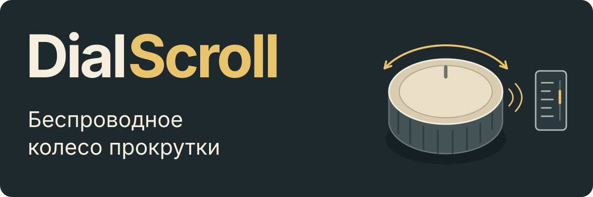
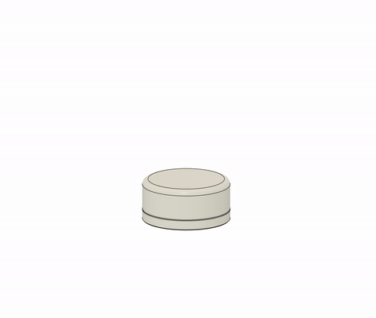
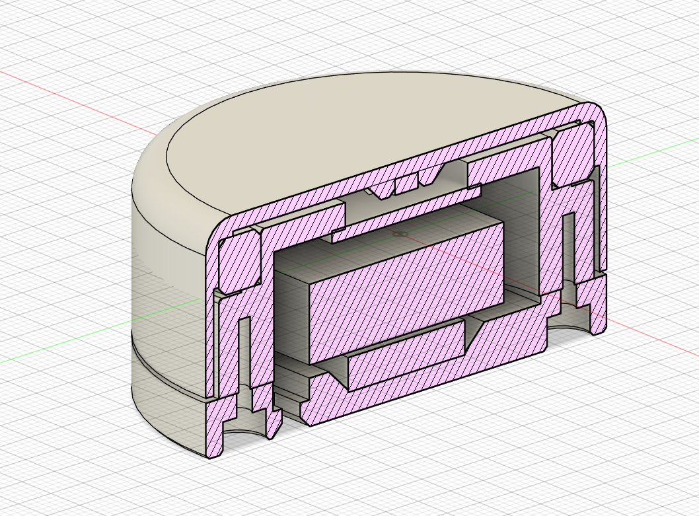

<a href="README.md">English</a> · <strong>Русский</strong>

<h1></h1>

Отдельное колесо для **прокрутки страниц и документов по Bluetooth**.
nRF52840 считывает угол магнитного энкодера и передаёт движения компьютеру как
HID-события. В репозитории есть прошивка и CAD-модель корпуса.

Поддерживаются магнитные энкодеры **MT6701 и AS5600**. Прошивка сама определяет
подключённую модель при старте.

[Корпус и CAD](#корпус) · [Как устроена прокрутка](#как-устроена-прокрутка) · [Сборка и прошивка](#сборка-и-прошивка)

## Корпус

CAD-модель корпуса: разнесение деталей и вид в разрезе.

  
  

[Fusion 360 (F3D)](hardware/cad/DialScroll.f3d) · [STEP](hardware/cad/DialScroll.step) · [Исходная анимация (AVI)](docs/assets/DialScroll.avi)

## Как устроена прокрутка

- **Полные обороты и малые движения.** Круговая фильтрация угла учитывает
  переход через ноль. Остаток движения накапливается до шага прокрутки
  и сохраняется между отчётами.
- **Настраиваемый шаг.** Режимы разрешения делают шаги мельче или крупнее при
  том же общем масштабе. Повышенное разрешение используется, когда его включает компьютер.
- **Ускорение по настройке.** Быстрое вращение увеличивает прокрутку; пауза или
  смена направления сбрасывает ускорение. По умолчанию оно выключено.
- **Питание датчика по активности.** При вращении прошивка часто считывает угол,
  в покое делает короткие проверки, а без Bluetooth-соединения выключает датчик.
- **Передача по Bluetooth с буфером.** Считывание датчика отделено от отправки:
  BLE передаёт накопленное движение по одному отчёту. Сопряжение и настройки
  сохраняются после выключения питания.

[Руководство по архитектуре](ARCHITECTURE.RU.md) описывает обработку сигнала,
фильтрацию, разрешение, управление питанием и USB-команды настройки.

## Сборка и прошивка

Распиновка подготовлена для **nRF52840-платы Tenstar Robot, совместимой с ProMicro**,
с UF2-загрузчиком, совместимым с `nice!nano`. Подключение показано в
[руководстве по аппаратной части](ARCHITECTURE.RU.md#подключение-и-контроль-аккумулятора).

Для Windows нужны **Zephyr / nRF Connect SDK 3.2.4** и его набор инструментов.
Двойное нажатие Reset открывает диск `NICENANO`. Строка `SoftDevice` в
`INFO_UF2.TXT` определяет команду, которая запускается из корня проекта:

| Значение `SoftDevice` | Команда |
|---|---|
| `S140 6.1.1` | `.\build.ps1 sd` |
| `not found` | `.\build.ps1 nosd` |

Для каталога проекта `DialScroll` вариант `sd` создаёт `blescroll.uf2` в
`build/DialScroll/`, а `nosd` — `blescroll_nosd.uf2` в `build-nosd/DialScroll/`.
[Скрипт](build.ps1) проверяет адреса загрузки образа. Другой путь к SDK задаётся
параметром `-NcsRoot C:\ncs\v3.2.4`; пути результата зависят от имени каталога проекта.

Копирование выбранного UF2 на `NICENANO` перезагружает плату. После сопряжения
с **AirScroll** вращение колеса в обе стороны позволяет проверить прокрутку.

`DialScroll` — имя проекта, **AirScroll** — имя в Bluetooth, а цели сборки и файлы
прошивки используют `blescroll`.
[Руководство по сборке и диагностике](ARCHITECTURE.RU.md#сборка-и-прошивка)
описывает сборку в Linux и пять профилей прошивки.

## Проверка

- **32 теста в QEMU** проверяют [обработку угла, ускорение и расчёты батареи](tests/encoder_math/src/main.c)
  и [сохранение настроек](tests/scroll_settings/src/main.c).
- **10 [тестов UF2](tests/uf2/test_verify_uf2.py)** проверяют структуру образа и адреса загрузки.
- [CI](.github/workflows/ci.yml) запускает эти тесты и собирает **пять профилей прошивки**.
