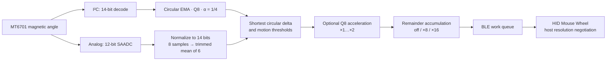

# DialScroll

English · [Русский](README.RU.md)

DialScroll is firmware for a wireless scroll wheel built around an MT6701 magnetic
angle sensor and an nRF52840 board with a `nice!nano` UF2 bootloader. It turns
absolute angular measurements into standard BLE HID Mouse Wheel reports.

The project brings together sensor interfaces, fixed-point signal processing,
adaptive power control and asynchronous BLE delivery in a Zephyr / nRF Connect SDK
application. The build target and firmware files use `blescroll`; the device
advertises as **AirScroll**.

## Engineering decisions

| Area | Implementation and purpose |
|---|---|
| Circular geometry | Both inputs share a 14-bit angle scale. Shortest signed deltas handle the transition between `16383` and `0` without a false full-turn jump. |
| Input-specific filtering | The I²C path uses a circular EMA with `α = 1/4` and Q8 state. The ADC path unwraps eight samples around a reference, discards the minimum and maximum, and averages the remaining six. |
| Scroll quantization | Retained remainders preserve fractional scroll steps and Q8 acceleration fractions. Runtime `off` / `×8` / `×16` modes change report granularity while preserving total distance for the same input movement. |
| Optional acceleration | A Q8 `×1…×2` multiplier uses an 80 ms motion window and activates after 45° of continuous rotation. Direction changes and pauses reset the estimate. |
| Sensor power control | A GPIO-controlled supply supports idle probes and active tracking. Normal operation powers the sensor only while BLE is connected; reconnection starts with a fresh baseline. |
| BLE delivery and persistence | A work queue sends accumulated Wheel reports with a single notification in flight, bounded retries and explicit connection references. NVS stores bonds, resolution, acceleration and input selection. |
| Bootable UF2 images | The application is linked at its physical flash address, then converted from Intel HEX to UF2 with those addresses preserved. This fixes the mismatch between relocated UF2 blocks and the reset vector. |

The implementation is split between the hardware-facing [encoder state machine](src/encoder.c),
testable [signal-processing functions](src/encoder_math.c),
[BLE transport](src/ble_hid.c) and [persistent settings](src/scroll_resolution.c).

## Signal pipeline

The HID descriptor advertises a `×16` Resolution Multiplier. Hosts that enable its
Feature report receive high-resolution units; other hosts receive legacy Wheel
detents. The transport retains a separate remainder for that conversion.

## Configured behavior

The firmware timing, thresholds and scale are configured in
[app_config.h](include/app_config.h).

| State or parameter | Configuration |
|---|---|
| Default input | MT6701 over I²C at 400 kHz, address `0x06`; ADC selectable at runtime |
| Sensor settling time | 33 ms after power-on before an idle reading |
| Idle probes | Every 100 ms for 10 s after motion, then every 200 ms; startup uses 200 ms |
| Active tracking | One sample cycle every 2 ms; returns to idle after 400 ms without significant motion |
| Motion thresholds | Idle: more than 32 counts; active: more than 16 counts on the 14-bit scale |
| Scroll scale | 256 angle counts per detent; default resolution `×16` |
| Acceleration | Off by default; after activation, linear from `×1` at ≤0.4 rev/s to `×2` at ≥2 rev/s |
| Battery reporting | Eight averaged ADC readings; BLE Battery Service update every 60 s |
| USB diagnostics | USB CDC enabled while VBUS is present; logging starts on command `D` |

The pin map, electrical connections, source switching and diagnostic modes are
documented in the [architecture and hardware guide](ARCHITECTURE.md).

## Quick build and flash

The Windows helper [build.ps1](build.ps1) uses an installed **nRF Connect SDK 3.2.4**
and its registered toolchain. Run it from the checkout root after selecting the
bootloader layout below. A different SDK location can be passed with
`-NcsRoot C:\ncs\v3.2.4`.

Double-press Reset to open the `NICENANO` drive and read `INFO_UF2.TXT`:

| `INFO_UF2.TXT` entry | Command | Application start | Output for a checkout named `DialScroll` |
|---|---|---|---|
| `SoftDevice: S140 6.1.1` | `.\build.ps1 sd` | `0x26000` | `build/DialScroll/blescroll.uf2` |
| `SoftDevice: not found` | `.\build.ps1 nosd` | `0x1000` | `build-nosd/DialScroll/blescroll_nosd.uf2` |

The helper derives the application output directory from the checkout name and
checks the generated UF2 before reporting success. The matching flash layout
determines which image the bootloader can start.

1. Copy the selected UF2 to `NICENANO`; the board reboots automatically.
2. Pair **AirScroll** in the host's Bluetooth settings.
3. Turn the wheel in both directions to check HID scrolling.
4. With USB connected, open the CDC serial port at `115200 8N1` and send `h` for
   command help or `D` for a diagnostic snapshot and live output; `d` stops output.

Single-byte commands `0` / `1` / `2` select resolution, `A` / `a` toggle
acceleration, and `V` / `v` select ADC / I²C. These choices persist across power
cycles. `U` requests a reboot into the UF2 bootloader.

The [full guide](ARCHITECTURE.md) covers wiring, Linux builds, diagnostic build
profiles, the complete command protocol and pairing recovery.

## Verification

The repository contains **31 ztests** in two suites configured for
`qemu_cortex_m3`:

| Suite | Coverage |
|---|---|
| [encoder_math](tests/encoder_math/src/main.c) · 25 tests | ADC normalization, MT6701 decoding, circular deltas and EMA, wrap-aware trimmed filtering, signed remainders, resolution distance/granularity, acceleration activation/curve/reset behavior, and the battery voltage table |
| [scroll_settings](tests/scroll_settings/src/main.c) · 6 tests | Defaults for older settings, acceleration/input reload, invalid or malformed input selection, and retaining the current input when saving fails |

The [CI workflow](.github/workflows/ci.yml) runs both suites and builds five UF2
profiles: `sd`, `nosd`, sensor diagnostics, BLE diagnostics and startup capture.
The [UF2 verifier](tools/verify_uf2.py) checks block structure, family ID, address
layout and the reset vector. Run status and logs are available in the repository's
**Actions** tab.

The [architecture guide](ARCHITECTURE.md) records the hardware setup, scheduling,
error recovery and reproduction commands alongside the implementation.
