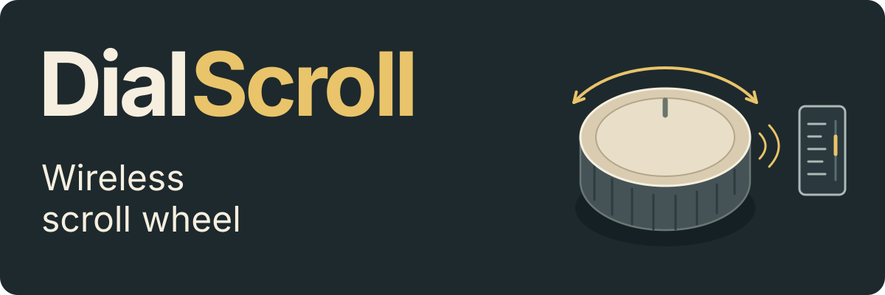

<strong>English</strong> · <a href="README.RU.md">Русский</a>

<h1></h1>

A standalone wheel for **scrolling pages and documents over Bluetooth**.
An nRF52840 reads a magnetic angle encoder and sends HID wheel events to the
computer. The repository contains the firmware and enclosure CAD.

Supports **MT6701 and AS5600** magnetic angle encoders, with automatic detection
of the connected model at startup.

[Enclosure and CAD](#enclosure) · [How scrolling works](#how-scrolling-works) · [Build and flash](#build-and-flash)

## Enclosure

The enclosure CAD is shown in an exploded view and a cross-section:

  
  

[Fusion 360 (F3D)](hardware/cad/DialScroll.f3d) · [STEP](hardware/cad/DialScroll.step) · [Original animation (AVI)](docs/assets/DialScroll.avi)

## How scrolling works

- **Continuous turns and small movements.** Circular angle filtering handles
  the transition across zero. Angular remainder accumulates until it forms a
  scroll step, preserving small movements between reports.
- **Adjustable scroll steps.** Resolution modes make steps finer or coarser at
  the same overall scale. High-resolution reports are used when enabled by the host.
- **Optional acceleration.** Faster turns scroll further; a pause or direction
  change resets acceleration. It is disabled by default.
- **Activity-based sensor power.** The firmware reads frequently during a turn,
  makes brief checks while idle and powers the sensor off without a Bluetooth connection.
- **Buffered Bluetooth delivery.** Sensor acquisition and sending are separate;
  BLE drains queued movement one report at a time. Pairing and user settings
  survive power cycles.

The [architecture guide](ARCHITECTURE.md) covers the signal path, filtering,
resolution, power scheduling and USB commands for changing settings.

## Build and flash

The supplied pinout targets a **Tenstar Robot ProMicro-compatible nRF52840 board**
with a `nice!nano`-compatible UF2 bootloader. Wiring is documented in the
[hardware guide](ARCHITECTURE.md#hardware-interface-and-battery-monitoring).

On Windows, install **Zephyr / nRF Connect SDK 3.2.4** and its toolchain.
Double-press Reset to open `NICENANO`, then read the `SoftDevice` line in
`INFO_UF2.TXT`. Run the matching command from the checkout root:

| `SoftDevice` value | Command |
|---|---|
| `S140 6.1.1` | `.\build.ps1 sd` |
| `not found` | `.\build.ps1 nosd` |

For a checkout named `DialScroll`, `sd` writes `blescroll.uf2` under
`build/DialScroll/`; `nosd` writes `blescroll_nosd.uf2` under
`build-nosd/DialScroll/`. The [helper](build.ps1) validates the image's boot
addresses. Add `-NcsRoot C:\ncs\v3.2.4` for another SDK location; output paths
follow the checkout name.

Copy the selected UF2 to `NICENANO`, let the board reboot, then pair **AirScroll**
and turn the wheel in both directions.

`DialScroll` is the project name; **AirScroll** is its Bluetooth name, while
firmware targets and files use `blescroll`. The
[build and diagnostics guide](ARCHITECTURE.md#build-and-flash-procedures)
covers Linux builds and the five firmware profiles.

## Verification

- **32 QEMU tests** cover [angle processing, acceleration and battery math](tests/encoder_math/src/main.c)
  and [persistent settings](tests/scroll_settings/src/main.c).
- **10 [UF2 tests](tests/uf2/test_verify_uf2.py)** cover image structure and boot addresses.
- [CI](.github/workflows/ci.yml) runs these tests and builds **five firmware profiles**.
