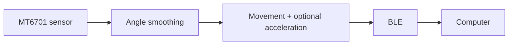
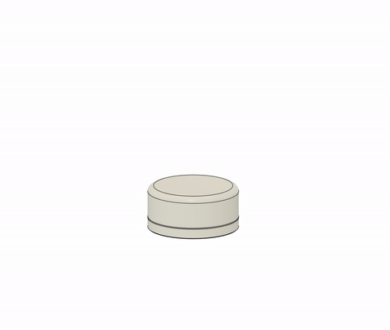
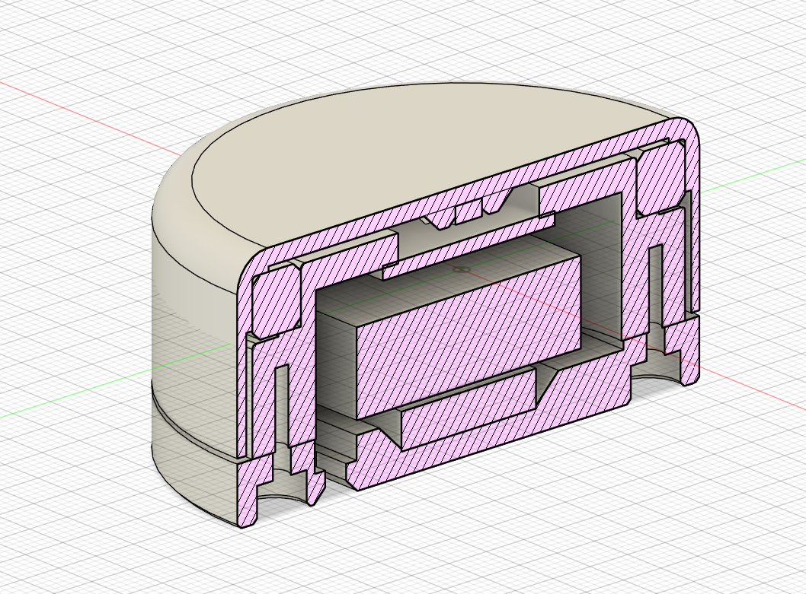

# DialScroll

English · [Русский](README.RU.md)

DialScroll is firmware for a wireless scroll wheel. An nRF52840 board reads an
MT6701 angle sensor and sends wheel movements to a computer over Bluetooth (HID).

Built with **Zephyr / nRF Connect SDK 3.2.4** for boards with a `nice!nano`-compatible
UF2 bootloader. The Bluetooth name is **AirScroll**; build targets and firmware
files use `blescroll`.

## Engineering decisions

- Angle smoothing follows the wheel across zero, keeping the end of a turn
  continuous with the start of the next.
- Small movements accumulate until they form a scroll step, preserving movement
  between reports. Resolution modes offer finer or coarser steps at the same scale.
- Optional acceleration scrolls further at higher speeds and resets after a pause
  or a direction change.
- Sensor power adapts to activity: frequent readings during turns, brief checks
  while idle, and off while Bluetooth is disconnected.
- BLE sends queued movements one report at a time. Pairing and user settings
  survive power cycles.

## Enclosure

3D CAD model of the enclosure.

| Exploded-view animation | Section view |
|---|---|
|  |  |

[Fusion 360 (F3D)](hardware/cad/DialScroll.f3d) · [STEP](hardware/cad/DialScroll.step) · [Original animation (AVI)](docs/assets/DialScroll.avi)

## Build and flash

On Windows, install the SDK and its toolchain, then run [build.ps1](build.ps1) from the
checkout root. Double-press Reset to open `NICENANO` and read `INFO_UF2.TXT` to
choose the matching command:

| `INFO_UF2.TXT` | Command | UF2 for checkout `DialScroll` |
|---|---|---|
| `SoftDevice: S140 6.1.1` | `.\build.ps1 sd` | `build/DialScroll/blescroll.uf2` |
| `SoftDevice: not found` | `.\build.ps1 nosd` | `build-nosd/DialScroll/blescroll_nosd.uf2` |

The helper checks boot addresses in the generated image. For another SDK location,
add `-NcsRoot C:\ncs\v3.2.4`; output directories follow the checkout name.

Copy the selected UF2 to `NICENANO`, let the board reboot, then pair **AirScroll**
and turn the wheel in both directions.

The [architecture guide](ARCHITECTURE.md) covers wiring, Linux builds, diagnostics
and algorithm details.

## Verification

- **31 QEMU tests** cover [angle processing and acceleration](tests/encoder_math/src/main.c)
  and [persistent settings](tests/scroll_settings/src/main.c).
- **10 [UF2 tests](tests/uf2/test_verify_uf2.py)** cover image structure and boot addresses.
- [CI](.github/workflows/ci.yml) runs these tests and builds **five firmware profiles**.
